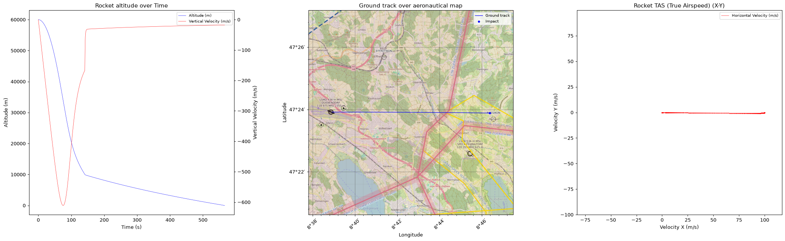

# Atmospheric Reentry Model

A Python toolkit for simulating the atmospheric reentry of a rocket stage,
in two clearly separated modes: a **realistic** mode with ECEF dynamics on
a rotating Earth, altitude-dependent gravity and air density, Earth-rotation
pseudo-forces and interpolated real wind fields from ERA5, and a
**simplified** flat-Earth mode that serves as a test box for
frame-independent physics (see *The two modes*).

Copyright 2026 Jonas Zbinden. Licensed under the MIT License (see
[`LICENSE`](LICENSE)). The ECMWF utilities `get_winddata.py` and
`compute_geopotential_on_ml.py` keep their own Apache 2.0 licence, stated in
their headers.

This software is provided "as is", without warranty of any kind, express or
implied. In no event shall the authors or copyright holders be liable for
any claim, damages or other liability arising from the use of the software.

> **Status:** work in progress. The physics runs end to end in both modes,
> but the model has not been formally validated against reference
> trajectories.

## Example output



A realistic-mode reentry from 60 km over Dübendorf airfield (LSMD),
Switzerland, `mass = 700 kg`, entry velocity 100 m/s east, parachute at
10 km. Left: altitude and vertical velocity over time (the kink near 10 km
is parachute deployment). Middle: ground track over the ICAO aeronautical
chart (openAIP airspaces, D°M′ graticule). Right: horizontal true airspeed.

---

## Installation

Requires **Python ≥ 3.10**.

```bash
python -m venv .venv
source .venv/bin/activate          # Windows: .venv\Scripts\activate
pip install -e .                   # installs the package and its dependencies
```

Dependencies (numpy, scipy, matplotlib, pandas, xarray, cfgrib, pymap3d,
joblib) are resolved automatically from `pyproject.toml`. Verify the
install with:

```bash
python -c "import tools; print('install OK')"
```

Optional extras:

```bash
pip install -e '.[basemap]'   # contextily + pyproj, for the ICAO ground-track map
pip install -e '.[dev]'       # pytest, mypy, ruff
```

---

## Project structure

```
.
├── pyproject.toml
└── src/
    ├── main.py               # single-run entry point (interactive or programmatic)
    ├── monte_carlo_run.py    # parallel Monte Carlo over wind conditions
    └── tools/                # the importable package
        ├── simulate_rocket.py    # Rocket: equations of motion, drag, time stepping
        ├── modes.py              # the two modes: definition and validation
        ├── state_estimation.py   # RealState: state store + ECEF <-> geodetic
        ├── utils.py              # PhysicsFunctions (gravity/drag/air density) + plotting
        ├── windfield.py          # WindField: default analytic wind and ERA5 interpolation
        ├── logging.py            # Logging: per-step buffers -> pandas DataFrame
        ├── constants.py          # physical constants
        ├── get_winddata.py       # download ERA5 model-level data (CDS API)
        ├── compute_geopotential_on_ml.py  # geopotential on model levels (ECMWF tool)
        ├── time.py               # placeholder for a future simulation clock (unused)
        └── windmodel_data/       # ERA5 GRIB data used by the ERA5 wind model
```

> **Note:** `main.py` and `monte_carlo_run.py` open the wind data through
> paths relative to the package (`./tools/windmodel_data/...`),
> so run them **from inside `src/`**.

---

## Configuration

Behaviour is driven by a `params` dictionary:

| Key                              | Values                              | Meaning |
|----------------------------------|-------------------------------------|---------|
| `mode`                           | `"simplified"` \| `"realistic"`     | flat-Earth test box vs rotating-Earth reentry model (see *The two modes*) |
| `wind`                           | `"default"` \| `"ERA5"` \| `"Monte Carlo"` | analytic constant wind, interpolated ERA5 wind, or per-run sampled wind |
| `mass`                           | float (kg)                          | rocket mass (point mass) |
| `drag_coefficient`               | float                               | drag coefficient above the parachute opening altitude |
| `drag_coefficient_parachute`     | float                               | drag coefficient below it (parachute deployed) |
| `cross_sectional_area`           | float (m²)                          | reference area above the parachute opening altitude |
| `cross_sectional_area_parachute` | float (m²)                          | reference area below it |
| `parachute_opening_altitude`     | float (m)                           | altitude below which the parachute values apply |
| `tmax`                           | float (s)                           | maximum simulated time |
| `max_step`                       | float (s)                           | maximum solver step size |
| `solver_method`                  | `"RK45"`                            | ODE solver; optional, only `"RK45"` is implemented |
| `basemap`                        | `True` \| `False`                   | draw an ICAO/aeronautical map behind the ground-track panel (realistic mode; see *Ground-track basemap*) |
| `verbose`                        | `True` \| `False`                   | print state every 100 steps |

### The two modes

The tool exists as two separate modes. They share every piece of physics
that does not depend on the reference frame, and differ only in the frame
and the environment models.

| | `simplified` (test box) | `realistic` (reentry model) |
|---|---|---|
| Earth and frame | flat, non-rotating; Cartesian x (east), y (north), z (altitude) | rotating WGS84 ellipsoid; state in ECEF |
| Gravity | constant 9.80665 m/s² along −z | central gravity with J2, plus Coriolis and centrifugal acceleration |
| Air density | constant sea-level value | exponential in geodetic altitude |
| Wind | one constant horizontal vector | constant, or interpolated from ERA5, in local east/north/up |
| Initial conditions | Cartesian position and velocity | geodetic position and east/north/up velocity, converted to ECEF |
| Output | Cartesian columns; geodetic columns are `NaN` | Cartesian (ECEF) and geodetic columns |
| Map | none | optional ICAO basemap |

**Shared by both modes:** the state layout `[position, velocity]`, the
equations of motion, the drag law, the parachute switch, the solver, the
logging and the main loop.

**What the simplified mode is for.** It is a test box for frame-independent
parts such as aerodynamic models, parachute logic, solver settings and
control loops. Exact solutions exist there (free fall, terminal velocity),
so a new model can be checked by hand before it is flown in realistic mode.
The test suite uses it in exactly this way. It is not a reentry model.

**Rules.** `mode` must be one of the two values; anything else raises a
`ValueError`. ERA5 wind and the basemap need the realistic mode, and
`"wind": "ERA5"` together with `"mode": "simplified"` raises a `ValueError`.

**In the code.** The modes are defined in `tools/modes.py`. Everything that
differs between them in the dynamics is bound in two methods of `Rocket`,
`_setup_simplified_mode` and `_setup_realistic_mode`; new frame- or
environment-dependent models belong there.

**Wind sources**

- **`default`** — constant horizontal wind from a direction and speed you
  pass in `wind_field_conditions = [direction_deg, speed_mps]`. Direction
  follows the aviation convention: the compass direction the wind blows
  from (0° = from north, 90° = from east, 180° = from south, 270° = from
  west).
- **`ERA5`** — real wind interpolated in space, time and altitude from
  pre-downloaded ERA5 GRIB data (see *Preparing ERA5 wind data*). Realistic
  mode only. Pass `wind_field_conditions = None`.
- **`Monte Carlo`** — used by `monte_carlo_run.py`; each parallel run draws
  its own `[direction_deg, speed_mps]`.

---

## Usage

### 1. Interactive single run

From `src/`:

```bash
cd src
python main.py
```

`main.py` prompts (via a small text menu) for the simulation mode and, in
realistic mode, the wind source and basemap. It runs one trajectory, prints
a summary, and shows a three-panel plot (altitude vs time, ground track, and
airspeed).

### 2. Programmatic single run

Build the pieces yourself and call `main()`, which returns a pandas
`DataFrame` of the full logged trajectory:

```python
import numpy as np
from tools.simulate_rocket import Rocket
from tools.logging import Logging
from tools.windfield import WindField
from tools.state_estimation import RealState
from main import main  # run this from the src/ directory

params = {
    "mass": 700,
    "drag_coefficient": 1.4,
    "drag_coefficient_parachute": 2.0,
    "cross_sectional_area": 1.14,
    "cross_sectional_area_parachute": 18,
    "parachute_opening_altitude": 10000,
    "tmax": 3000,
    "max_step": 0.3,
    "wind": "ERA5",
    "mode": "realistic",
    "verbose": False,
}

# Step budget for the run, which is also the size of the log buffers.
n_steps = 2 * int(np.ceil(params["tmax"] / params["max_step"]))

# Realistic mode expects Cartesian (ECEF) initial conditions. Convert from
# a geodetic launch/entry point (velocity is east, north, up):
lat, lon, alt = 38.5, 285.0, 60000.0
position_init = np.array([lat, lon, alt])
velocity_init = np.array([70.0, 70.0, -280.0])
position = RealState.convert_geodetic_to_cartesian(position_init)
velocity = RealState.convert_velocity_geodetic_to_cartesian(velocity_init, lat, lon)

logger = Logging(n_steps, initial_conditions_geodetic=[position_init, velocity_init])
wind = WindField(
    start_time="2026-06-05T13:00:00",
    params=params,
    logger=logger,
    wind_field_conditions=None,
)
rocket = Rocket(
    initial_conditions=[position, velocity],
    params=params,
    logger=logger,
    wind_field=wind,
)

df = main(n_steps, rocket, verbose=False)
print(df[["time", "altitude", "position geodetic lat", "position geodetic lon"]].tail())
```

For a **simplified** run, skip the coordinate conversion and pass plain
Cartesian initial conditions, e.g. `position = np.array([0, 0, 60000])`,
`velocity = np.array([70, 70, -280])`, with `"wind": "default"` and
`wind_field_conditions=[270, 15]`.

The simulation stops when the altitude drops below zero (impact) or when
`tmax` is reached.

### 3. Monte Carlo ensemble

From `src/`:

```bash
cd src
python monte_carlo_run.py
```

Runs many trajectories in parallel (via `joblib`) with wind direction and
speed sampled per run, and plots all trajectories together to show the
spread of impact points. Sample count and parameters are set at the top of
`monte_carlo_run.py`.

---

## Output

`logger.get_full_state()` returns a `DataFrame` with one row per simulated
step, including: `time`; Cartesian position/velocity (`position cartesian
x/y/z`, `velocity cartesian x/y/z`); geodetic position/velocity (`position
geodetic lat/lon/alt`, `velocity geodetic East/North/alt`); `altitude`;
`drag_force`; `air_density`; `grav_acc norm`; `geopotential`;
`wind_velocity`; and per-step `warnings`. In `simplified` mode the geodetic
columns are `NaN` (no meaningful lat/lon on a flat Earth).

---

## Preparing ERA5 wind data

The `ERA5` wind model reads GRIB files from
`src/tools/windmodel_data/`. Sample data is included. To
generate data for a different date or region:

1. `get_winddata.py` downloads ERA5 model-level fields (temperature, u/v
   wind, humidity, geopotential, log surface pressure) via the Copernicus
   **CDS API** — this requires the `cdsapi` package and a (free) CDS
   account with credentials configured.
2. `compute_geopotential_on_ml.py` (an ECMWF utility) converts the model-
   level fields into geopotential on model levels (`z_out.grib`), which the
   wind model uses to map altitude to model level.

The horizontal area and date are fixed by the download request in
`get_winddata.py`; a trajectory that leaves the downloaded area or altitude
range gets zero wind (with a logged warning) rather than an error.

---

## Ground-track basemap (ICAO / aeronautical map)

In **realistic** mode you can draw a map behind the ground-track panel to see
where the trajectory would fly. Enable it with `params["basemap"] = True`
(it is off by default so headless/offline runs are unaffected).

The track is reprojected to Web Mercator and drawn undistorted on a square
panel with degree tick labels; the zoom level is chosen from the track extent
and clamped so a near-vertical drop does not request absurdly deep tiles.

**Requirements:**

1. Install the optional extra: `pip install -e '.[basemap]'` (contextily +
   pyproj).
2. **Base map** (terrain, roads, place names) needs **no key** — it comes
   from OpenStreetMap.
3. **ICAO airspaces / navaids** come from the [openAIP](https://www.openaip.net)
   overlay, which needs a free API key. Provide it either as an environment
   variable:

   ```bash
   export OPENAIP_API_KEY=your-key-here
   ```

   or in a **`.env` file** at the repo root (or any parent of the working
   directory):

   ```
   OPENAIP_API_KEY=your-key-here
   ```

Without a key you still get the base map and track, plus a one-line warning
that airspaces are not drawn. Tiles are fetched over the network at plot
time, so this needs internet access.

> **Security:** `.env` is listed in `.gitignore` — keep your key out of
> version control. Never commit it.

---

## Contact

Questions or problems: **jonas_zbinden@bluewin.ch**
